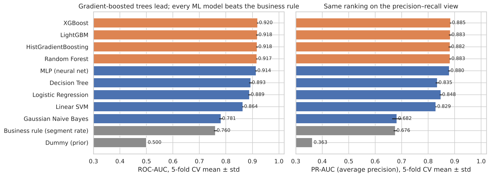
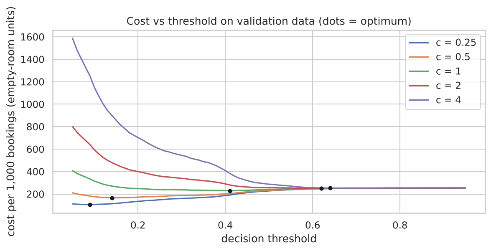
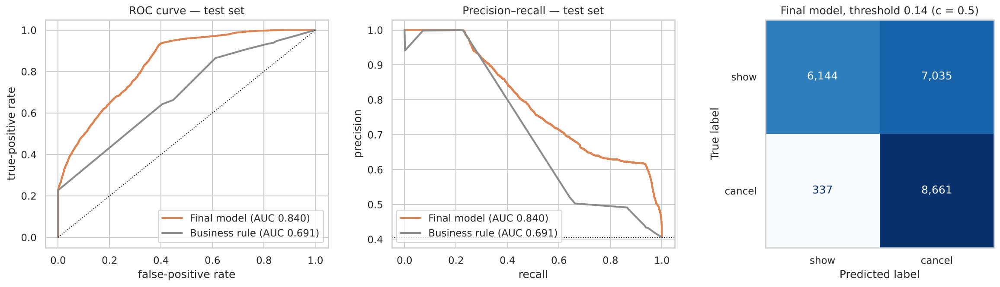
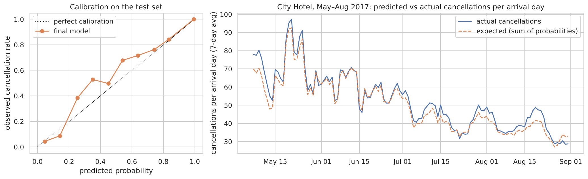
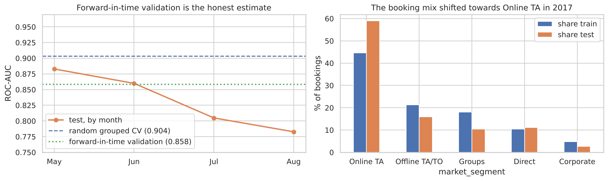
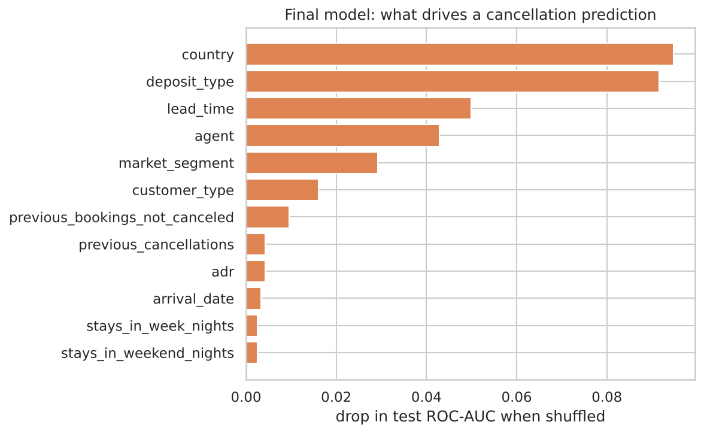

# 🏨 Predicting Hotel Booking Cancellations
### A Proof-of-Value study for hotel revenue management — INSY 674, McGill MMA (Fall 2026)

> **Team:** Group8 · **Members (GitHub):** Zijia Zhang ([@zhangaiyou07](https://github.com/zhangaiyou07)), Zhou Mo ([@MoZhou-vicky](https://github.com/MoZhou-vicky)), Yang Cassie ([@cass1eoo](https://github.com/cass1eoo)), Liu Zexi ([@zexisui](https://github.com/zexisui)), Liu Siyu ([@Siyu-Liu123](https://github.com/Siyu-Liu123))
>
> **Repository:** [github.com/zhangaiyou07/hotel-cancellation-prediction](https://github.com/zhangaiyou07/hotel-cancellation-prediction)

**One-line summary:** using only information available **when a booking is created**, our tuned XGBoost model ranks cancellation risk on bookings from a *later* period with **ROC-AUC 0.840 (95% CI 0.829–0.852) vs 0.691 for today's rule of thumb**; contacting the 30% riskiest bookings would reach **55% of all cancellations with 74% precision** (the rule: 44% / 59%).

---

## Repository structure

```
├── README.md                              ← this document (project write-up following the ML Project Checklist)
├── requirements.txt
├── data/
│   ├── hotel_bookings.csv                 ← Kaggle "Hotel booking demand" (119,390 bookings)
│   └── README.md                          ← source & licence
├── src/
│   ├── features.py                        ← cleaning, temporal split, leakage removal, feature engineering, pipelines
│   └── evaluation.py                      ← grouped cross-validation, metrics, threshold selection
├── notebooks/
│   ├── 01_eda.ipynb                       ← Frame the problem + Explore the data
│   ├── 02_prepare_and_shortlist.ipynb     ← Prepare the data + Shortlist & compare models + error analysis
│   ├── 03_finetune_and_evaluate.ipynb     ← Fine-tune, ensembles, final test, business translation
│   └── *.py                               ← plain-text (jupytext) copies of the notebooks for readable git diffs
├── reports/figures/                       ← every chart used in the notebooks and the slides
└── models/                                ← final_model.joblib (pipeline + threshold), CV results, OOF predictions, test results
```

**Reproduce:**
```bash
pip install -r requirements.txt
cd notebooks
jupyter nbconvert --to notebook --execute --inplace 01_eda.ipynb 02_prepare_and_shortlist.ipynb 03_finetune_and_evaluate.ipynb
```
Runtime on a 2-core laptop: ~1 min (01), ~15 min (02), ~17 min (03). All randomness is seeded (`random_state=42`).

---

## 1. Frame the Problem and Look at the Big Picture

| Question | Our answer |
|---|---|
| **Objective (business)** | Reduce revenue lost to cancellations. In this data **37% of bookings are cancelled**; every cancellation that is not re-sold is an empty room. |
| **Who uses it and how?** | The **revenue-management team** of each hotel. Every new booking is scored **once, when it is created** (new bookings scored in a nightly batch; open bookings re-scored only when the model is retrained monthly), using only information available at that moment — because **half of all cancellations happen 7+ weeks before arrival** (median 48 days in the training data), a warning close to arrival would come too late. The team uses it to **(1) set the overbooking level per night** (sum of probabilities = expected cancellations) and **(2) act on high-risk bookings** — reminder e-mail, "confirm your stay" offer, or a deposit request. |
| **Current solution / workaround** | Rules of thumb: historical cancellation rate per segment, or a flat seasonal overbooking rate. We implement *"cancellation rate of the booking's hotel × market segment × deposit type"* as the **business baseline**. |
| **Framing** | **Supervised binary classification** on tabular data (target `is_canceled`). **Offline / batch learning**: retrain monthly, score nightly — booking behaviour changes over weeks, not minutes, so online learning is not needed (but monthly retraining is, see §6). |
| **Performance measure** | **ROC-AUC** (main — the team works down a list sorted by risk, so ranking quality matters) and **PR-AUC** (focus on the cancelled class). For the action list we pick the **probability threshold that minimises a business cost** (missed cancellation = 1 empty room, false alarm = c; base case c = 0.5, sensitivity 0.25–4) on validation predictions. |
| **Aligned with the objective?** | Accuracy would be misleading (63% for "nobody cancels"). AUC rewards correct ordering (what a ranked action list needs); precision controls how many loyal guests we bother; **calibrated probabilities** are needed for the overbooking use-case, so we also check calibration and translate results into "% of cancellations caught for a given effort". |
| **Evaluation protocol** | **Out-of-time test set**: train on arrivals Jul-2015 → Apr-2017 (97,031 bookings), test on arrivals **May → Aug 2017** (22,177), used once, with bootstrap confidence intervals and a de-duplicated control. **Tuning and model selection use forward-in-time validation** inside the training period. |

---

## 2. Explore the Data → [`01_eda.ipynb`](notebooks/01_eda.ipynb)

**Data:** *Hotel booking demand* (Antonio, Almeida & Nunes, 2019, *Data in Brief*) via [Kaggle](https://www.kaggle.com/datasets/jessemostipak/hotel-booking-demand). Two Portuguese hotels — a **City Hotel** (Lisbon) and a **Resort Hotel** (Algarve) — 119,390 bookings, 32 attributes. The test set was split off **before** any exploration.

The notebook profiles **every attribute** (type, % missing, distinct values, distribution/skew, noise, usefulness) in a table, then visualises the key relationships, each with a written takeaway.

| | Finding |
|---|---|
| 🎯 Target | 36% of training bookings cancel; City Hotel 42% vs Resort 26% → mildly imbalanced, accuracy is not a useful metric. |
| ⏱️ Lead time | The #1 numeric driver: cancellation risk grows from **6% (same-day) to 70–80% (9+ months ahead)**. Heavily right-skewed → `log1p` transform. |
| 💳 Deposit type | **Non-Refund deposits cancel 99% of the time** (counter-intuitive). 97% of them are Groups/Offline-TA bookings, 97% coded Portugal, median lead time 197 days, 98% duplicate rows → **room blocks** reserved by operators and released later. |
| 🙋 Engagement | 93% of guests with a previous cancellation cancel again. Parking and special requests look extremely protective (0% of parking requesters cancel; one request cuts risk from 47% to 19%) — **but they are recorded after the booking is made** (see timing below). |
| ⏰ Cancellation timing | Using `reservation_status_date` (analysis only, never a feature): **median cancellation 48 days before arrival; 84% more than a week ahead; only 7% in the last day.** → The model must predict **at booking time**. |
| 🌍 Country | Portuguese bookings cancel ~56% vs 15–35% for other top countries — but nationality may only be corrected at check-in (dataset paper) → **possible partial leakage**, tested explicitly. |
| ❓ Missing values | Only 4 columns: `company` 94% and `agent` 14% (= "none" → turned into flags/categories), `country` 0.5%, `children` 4 rows. |
| 🔁 Duplicates | **28% of rows are exact duplicates** (no booking ID → most likely multi-room group bookings). Kept, but **grouped in cross-validation** so identical rows never sit in both train and validation folds. |
| 🧹 Noise | 182 rows (0.15%) removed: 0-guest bookings, negative and 5,400 € `adr`. `Undefined` codes → missing. |
| 📈 Correlations | No numeric feature has \|r\| > 0.32 with the target; categorical variables are stronger → the signal is spread and non-linear → tree ensembles expected to win. |
| 📅 Time | Monthly cancellation rate moves between ~20% and ~45% with season, no long-term trend → a temporal split is fair. |

**Data leakage audit** (features must be known **at booking time**):

| Column | Decision | Reason |
|---|---|---|
| `reservation_status` | ❌ dropped | `Canceled`/`No-Show` ⇔ target |
| `reservation_status_date` | ❌ dropped | date of the outcome |
| `assigned_room_type` | ❌ dropped | assigned at check-in (21% of stays get a different room vs 2% of cancellations) |
| `country` | ⚠️ ablation | may be corrected at check-in; final test reported with and without it |
| `total_of_special_requests`, `required_car_parking_spaces`, `booking_changes` | ❌ dropped from the main model | filled in / updated after the booking is created (the dataset paper extracted values as of the day before arrival) → not available when the prediction is needed. Reported only as an *upper bound* |
| `deposit_type`, `days_in_waiting_list` | ✅ kept | set when the booking is confirmed (assumption) |

**Promising transformations:** `log1p(lead_time)`, total nights / guests, `has_kids`, weekend share, `adr` per guest, total booking value, arrival **and booking** month/weekday, previous-cancellation ratio, flags (`has_agent`, `has_company`), grouping rare `agent`/`country` levels.

**Extra data that would help:** a booking ID + timestamp, **time-stamped change logs** (to know when requests / parking / changes were added, so they could be used safely), payment/card-guarantee status, price paid vs. current public price (rebooking cheaper), free-cancellation deadline, e-mail engagement, loyalty history, local events/holidays, competitor prices.

---

## 3. Prepare the Data → [`src/features.py`](src/features.py), [`02_prepare_and_shortlist.ipynb`](notebooks/02_prepare_and_shortlist.ipynb)

Everything is automated in one **scikit-learn `Pipeline`**, so every learned step is fitted on training folds only (**leak-free**):

```
raw booking rows
  └─ FeatureEngineer      (stateless) drop leaky + post-booking columns, create 16 engineered features
  └─ ColumnTransformer
       ├─ numeric:     SimpleImputer(median) → StandardScaler   (scaler only for linear / SVM / NB / MLP)
       └─ categorical: SimpleImputer("missing") → OneHotEncoder | OrdinalEncoder (min_frequency → rare levels grouped)
  └─ model
```
* **Cleaning** rules that learn nothing (error rows, `Undefined` → NaN) are applied before the split (`basic_clean`).
* **Scaling** is used only where it matters (distance/gradient-based models); trees get an ordinal encoding.
* **Data-prep choices are parameters** (`use_country`, `booking_time`, `engineered`, `min_frequency`) so they can be ablated and tuned.
* **Validation — three schemes compared** (same LightGBM pipeline):

  | Scheme | ROC-AUC | Validation rows with a model-identical twin in training |
  |---|---|---|
  | plain `StratifiedKFold` (random 5 folds) | 0.929 | **37%** → inflated |
  | `StratifiedGroupKFold`, grouped by a hash of the **model-visible features** | 0.918 ± 0.004 | 0% |
  | **forward-in-time** (expanding window: validate May–Aug 2016, Sep–Dec 2016, Jan–Apr 2017) | **0.828 ± 0.045** | 0% |

  The grouping key must use only the columns the model sees: an earlier key that hashed all raw columns (including
  `reservation_status`, `booking_changes`) still left ≈ 12% twins. Grouped 5-fold CV is used for the broad model
  comparison; **forward-in-time validation is used for tuning, model selection and the threshold** (notebook 03).

---

## 4. Shortlist Promising Models — Measure and Compare → [`02_prepare_and_shortlist.ipynb`](notebooks/02_prepare_and_shortlist.ipynb)

Nine model families with default hyper-parameters + two baselines, **5-fold grouped CV (mean ± std)**:

| Model | ROC-AUC | PR-AUC | F1 @0.5 | Recall @0.5 |
|---|---|---|---|---|
| **XGBoost** | **0.920 ± 0.003** | **0.885** | 0.753 | 0.698 |
| LightGBM | 0.918 ± 0.004 | 0.883 | 0.747 | 0.680 |
| HistGradientBoosting | 0.918 ± 0.004 | 0.883 | 0.747 | 0.679 |
| Random Forest | 0.917 ± 0.003 | 0.883 | 0.752 | 0.683 |
| MLP (neural net) | 0.914 ± 0.003 | 0.880 | 0.757 | 0.718 |
| Decision Tree (depth 10) | 0.894 ± 0.006 | 0.835 | 0.685 | 0.587 |
| Logistic Regression | 0.889 ± 0.005 | 0.848 | 0.700 | 0.614 |
| Linear SVM (calibrated) | 0.864 ± 0.003 | 0.829 | 0.714 | 0.693 |
| Gaussian Naive Bayes | 0.781 ± 0.006 | 0.682 | 0.611 | 0.604 |
| *Business rule (segment rate)* | *0.760 ± 0.013* | *0.675* | *0.522* | *0.354* |
| *Dummy (prior)* | *0.500* | *0.363* | *0.000* | *0.000* |



**Most significant variables** (permutation importance, agreed by LightGBM and Logistic Regression): **country, deposit type, agent, lead time, previous cancellations, market segment**. Logistic-regression coefficients give the direction (Non-Refund deposit, cancellation history, Portuguese bookings and a few specific travel agents ↑ risk; no-deposit/refundable bookings and other agents ↓ risk).

**Error analysis** (out-of-fold, LightGBM): Non-Refund/Group bookings are 99.8% correct. **False alarms** concentrate in Online-TA bookings (17.5% of them) made 1–6 months ahead; **missed cancellations** are mostly short-lead-time and Direct/Corporate bookings, which look like "safe" bookings. A human would use payment guarantee, price-drop and engagement data that the dataset lacks.

**Iteration (ablations):** one data-preparation choice changed at a time (LightGBM, same CV):

| Variant | ROC-AUC | Δ |
|---|---|---|
| Main pipeline (booking-time features, engineered features, country, rare-level threshold 50) | 0.9184 | – |
| Original columns only (no feature engineering) | 0.9189 | +0.0005 |
| **Without `country`** | **0.8632** | **−0.055** |
| Rare-level threshold 10 / 200 | 0.9186 / 0.9179 | ±0.0005 |
| **+ post-booking columns (parking, special requests, changes)** — *upper bound, not deployable* | **0.9442** | **+0.026** |
| *Logistic Regression: engineered vs original columns* | *0.889 vs 0.878* | *+0.012 (F1 +0.02)* |

Feature engineering makes no difference for boosted trees (within fold noise; they learn the transformations themselves) but helps the linear model. `country` is the most influential choice → carried to the final test as a lower-bound check. The post-booking columns would add 0.026 AUC — the "price" of predicting early enough to be useful.

**Shortlist (4 models, chosen for accuracy *and* diverse errors):** XGBoost, LightGBM, Random Forest, MLP. HistGB was dropped (error correlation 0.995 with LightGBM); Logistic Regression is kept as the interpretable reference.

---

## 5. Fine-Tune the System → [`03_finetune_and_evaluate.ipynb`](notebooks/03_finetune_and_evaluate.ipynb)

**Validation for tuning and selection: forward-in-time** (expanding window — train on everything before, validate on the next four months: May–Aug 2016, Sep–Dec 2016, Jan–Apr 2017). **Search method — `RandomizedSearchCV`** (checklist: prefer random over grid search when there are more than a few hyper-parameters): 20 configurations per booster, 8 for Random Forest and MLP, scoring ROC-AUC. The **rare-category threshold (`min_frequency`) is searched jointly** with the model parameters (a data-preparation choice treated as a hyper-parameter).

| Model (forward-in-time ROC-AUC, mean of 3 windows) | Default | Tuned | Gain |
|---|---|---|---|
| **XGBoost** | 0.841 | **0.859 ± 0.026** | +0.018 |
| MLP | 0.847 | 0.853 ± 0.008 | +0.006 |
| Random Forest | 0.832 | 0.849 ± 0.021 | +0.017 |
| LightGBM | 0.828 | 0.848 ± 0.029 | +0.021 |

Validated forward in time, the search prefers **conservative models** (XGBoost: depth 4, `min_child_weight` 17.6, learning rate 0.02) — simpler trees transfer better to a future whose booking mix has shifted.

**Ensembles** (ROC-AUC on the 2nd and 3rd windows, where stacking can also be scored forward in time): XGBoost alone 0.8725, voting XGB+LGBM 0.8724, voting of all four 0.8722, stacking 0.8696 → **no ensemble beats tuned XGBoost.**

**Final model (rule fixed before testing: best validation score; the simplest option within 0.002):** **tuned XGBoost.**

**Decision threshold from a business cost** (on validation predictions): `cost = missed cancellations × 1 + false alarms × c`, with **c = cost of a false alarm ÷ cost of an empty room**. Base case **c = 0.5** (targeted-action use: a contact / small offer costs about half an empty room — an assumption), fixed before the test:

| c | 0.25 | **0.5** | 1 | 2 | 4 |
|---|---|---|---|---|---|
| threshold | 0.09 | **0.14** | 0.41 | 0.62 | 0.64 |
| share of bookings flagged (validation) | 65% | **52%** | 24% | 12% | 12% |
| precision / recall (validation) | 0.53 / 0.92 | **0.60 / 0.84** | 0.79 / 0.52 | 0.99 / 0.33 | 0.99 / 0.33 |



## 6. Results on the held-out test set (May – Aug 2017, evaluated once)

Nothing was tuned after this evaluation.

| | ROC-AUC (95% CI) | PR-AUC (95% CI) | Precision | Recall | F1 |
|---|---|---|---|---|---|
| Dummy ("everyone shows up") | 0.500 | 0.406 | – | 0.000 | 0.000 |
| Business rule (segment rate, cost threshold c = 0.5) | 0.691 (0.674–0.711) | 0.611 (0.577–0.644) | 0.520 | 0.642 | 0.575 |
| **Final model — tuned XGBoost, booking-time features (thr 0.14, c = 0.5)** | **0.840 (0.829–0.852)** | **0.791 (0.767–0.814)** | **0.552** | **0.963** | **0.702** |
| *Sensitivity: without `country` (lower bound)* | *0.795* | *0.761* | | | |
| *Sensitivity: + post-booking columns (upper bound, not deployable)* | *0.878* | *0.834* | | | |
| *De-duplicated control: single bookings only (70% of test) — model / rule* | *0.782 / 0.609* | *0.607 / 0.408* | | | |

* 95% intervals: bootstrap over the test set (300 resamples of whole duplicate groups). The paired model − rule difference is **+0.138 to +0.159 ROC-AUC**.
* **Validation estimates for the same model:** random grouped 5-fold CV 0.904, forward-in-time 0.858, test 0.840 → forward-in-time validation is the one to trust.
* The **de-duplicated control** shows repeated group blocks lift the headline score; on single bookings the model is weaker (0.78) but its lead over the rule is even larger.
* At c = 0.5 the model flags 71% of test bookings (cheap actions → contact many). The fairer comparison is at **fixed effort** or **by cost** below.



**Business translation**

| Contact the riskiest… | Model: % of all cancellations caught | Model: precision | Rule: caught | Rule: precision |
|---|---|---|---|---|
| 10% of bookings | 24.2% | 98.2% | 23.6% | 95.8% |
| 20% | 41.2% | 83.6% | 33.9% | 68.7% |
| **30%** | **54.7%** | **73.9%** | 43.8% | 59.3% |
| 40% | 66.8% | 67.8% | 53.8% | 54.6% |

| Cost per 1,000 bookings (empty-room units) | c = 0.25 | c = 0.5 | c = 1 | c = 2 | c = 4 |
|---|---|---|---|---|---|
| best simple policy (nobody / everybody / rule) | 145.9 | 265.3 | 313.8 | 313.8 | 313.9 |
| **model** | **106.7** | **173.8** | **273.5** | 310.5 | 318.5 |
| saving | 27% | **34%** | 13% | 1% | −1% |

→ **The model pays off for low-cost actions** (reminders, confirmation offers, soft overbooking). For expensive false alarms (walking a guest), it only flags the same obvious group blocks as the rule.

* **Overbooking:** summing the probabilities per arrival day tracks daily cancellations closely in shape (daily error ≈ 16%), but is **slightly too low** (predicted 36.1% vs actual 40.6%) → re-calibrate on recent data before using it for overbooking.



**Why the test score drifts below validation** (diagnosed without changing the model):
1. **Validation scheme matters**: random grouped CV 0.904 → forward-in-time 0.858 → test 0.840.
2. **Performance decays with time**: ROC-AUC 0.883 in May 2017 → 0.783 in August → retrain monthly.
3. **The business mix changed**: Online-TA bookings rose from 45% to 59%, while Groups, Non-Refund blocks and Portuguese bookings (the "easy" segments) shrank, and ordinary No-Deposit bookings cancelled more (27% → 35%).



**What drives predictions** (permutation importance on test): country, deposit type, lead time, agent, market segment, customer type — the same drivers as in the EDA.



---

## 7. Assumptions & limitations

| # | Assumption / limitation | Likely impact | How to address it |
|---|---|---|---|
| 1 | **`country` is known at booking time.** The dataset paper says nationality is often only confirmed at check-in. | If it is corrected only for arriving guests, the main model is optimistic by ≈ 0.045 AUC (0.840 → 0.795). | Ask the hotel IT team how/when the field is updated; if in doubt, deploy the no-country model. |
| 2 | **The model predicts at booking time**, so parking, special requests and booking changes are excluded (they are filled in later; half of all cancellations happen 7+ weeks before arrival). `deposit_type` and `days_in_waiting_list` are assumed to be set at confirmation. | Leaving the three columns out costs ≈ 0.04 AUC (0.878 → 0.840). If `deposit_type` were also updated later, the model would be somewhat optimistic. | Get time-stamped change logs; ask for parking / requests in the booking form; re-score bookings as new information arrives (a second, "closer to arrival" model). |
| 3 | **Duplicate rows are separate rooms of group bookings** (no booking ID). | If some are true duplicates, group cancellations are over-weighted. | Get the booking/group ID from the PMS. |
| 4 | **Concept drift** — the 2017 booking mix and cancellation rate differ from 2015-16. | AUC falls from 0.88 to 0.78 within four months; probabilities under-estimate risk. | Monthly retraining, recalibration on the last months, monitoring of AUC and calibration per month. |
| 5 | **Two hotels in Portugal, 2015-2017, pre-COVID.** | Patterns (e.g. Non-Refund group blocks, OTA behaviour) may not transfer to other hotels or to today's market. | Retrain per property; validate on recent data before rollout. |
| 6 | **The cost ratio c = 0.5 is assumed**, not measured. | The threshold moves from 0.14 (c = 0.5) to 0.62 (c = 2); the model's saving shrinks from 34% to ≈ 0 as false alarms get expensive. | Measure the cost of an empty room vs. a contact / an overbooked "walk" with revenue management; re-pick the threshold. |
| 7 | **No causal claim.** The model predicts who cancels; it does not tell us whether a reminder or deposit request *prevents* a cancellation. | Actions could be ineffective or annoy guests. | A/B test the interventions (uplift modelling — Module 4 causal inference). |
| 8 | **Repeated group bookings lift the headline score** (no booking ID). | On single bookings ROC-AUC is 0.78, not 0.84. | Report both; get booking IDs. |
| 9 | Limited tuning budget (20 / 8 random configurations). | Small further gains possible. | Bayesian optimisation (e.g. Optuna) on the same forward-in-time folds. |

---

## 8. What worked, what did not

**Worked ✅**
* A **leakage audit** before modelling — removing `reservation_status`, its date and `assigned_room_type` (a naive model with them is near-perfect and useless).
* Asking **when** the prediction is needed: cancellation timing (median 48 days before arrival) showed that the model must work at booking time, which ruled out three more columns that looked very predictive.
* **Grouping CV folds by model-visible duplicates** (plain folds: 37% of validation rows had a twin in training).
* **Forward-in-time validation for tuning and selection**: its estimate (0.858) was close to the test (0.840), while random CV said 0.904; it also selected a more conservative model.
* **Boosted trees**: +0.15 AUC over the business rule on the test set (95% CI of the difference 0.138–0.159).
* Translating results into **business terms**: cancellations caught per contact effort, cost per 1,000 bookings across cost ratios, daily expected cancellations.

**Did not work / limited value ❌**
* **Feature engineering for the tree models**: no measurable gain (it helps the linear model: +0.012).
* **Ensembles and stacking**: no gain over tuned XGBoost.
* **Random K-fold CV as a performance estimate**: optimistic by ≈ 0.06 AUC for a forecasting problem (our first version tuned on it; we switched).
* **The model for expensive actions (c ≥ 2)**: no better than the rule — it only adds value when false alarms are cheap.
* **Naive Bayes**: violated independence assumption → worst model.

**Interesting things we noticed 💡**
* Non-refundable deposits cancel 99% of the time — they are tour-operator room blocks, not guests losing money.
* Not a single guest who asked for a parking space cancelled — but that information arrives too late to be used.
* Portuguese bookings cancel 3× more often — partly real behaviour, partly a possible data-recording artefact.
* Half of all cancellations happen 7+ weeks before arrival; only 7% on the last day.

**Team contributions:** all five members of Group8 (Zijia Zhang, Zhou Mo, Yang Cassie, Liu Zexi, Liu Siyu) worked on
the project together: we jointly discussed the problem framing and the model parameters, analysed the issues found in
each other's notebooks, revised this notebook pipeline together, and built the presentation as a team. Individual
notebooks and reviews shaped several key decisions — the booking-time framing and the removal of post-booking columns,
the model-visible duplicate grouping key, the cost-based threshold with sensitivity analysis, the de-duplicated control
and bootstrap intervals, and forward-in-time validation for tuning.

---

## References
* N. Antonio, A. de Almeida, L. Nunes (2019). *Hotel booking demand datasets.* Data in Brief 22, 41–49.
* A. Géron (2019). *Hands-On Machine Learning with Scikit-Learn, Keras & TensorFlow*, 2nd ed., Appendix B (ML Project Checklist).
* J. Bergstra, Y. Bengio (2012). *Random search for hyper-parameter optimization.* JMLR 13.
* INSY 674 course material (F. Nayebi): Feature Engineering, SOTA Supervised Learning (ensembles, imbalanced classes, stacking).
